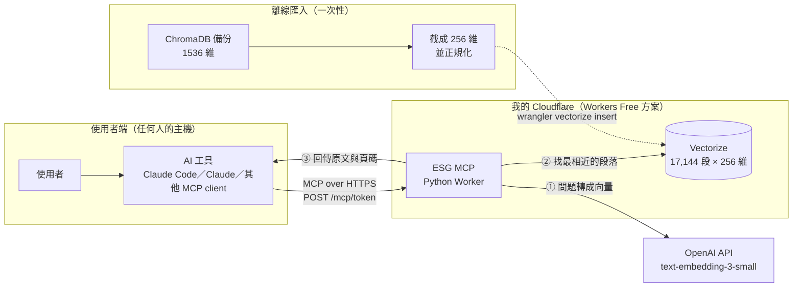
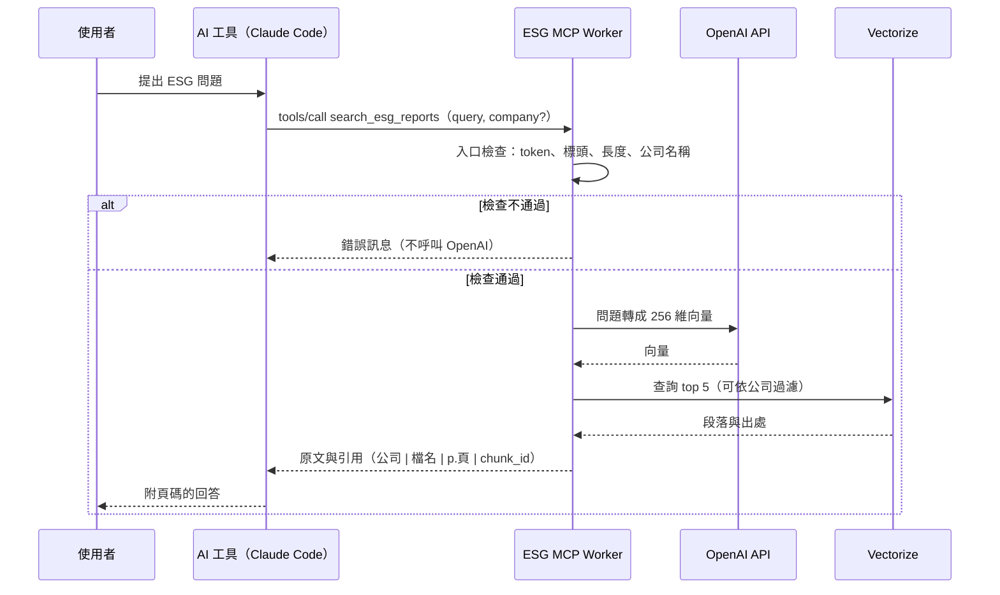

<div align="center">

# 台灣 50 ESG 報告 MCP Server

讓任何 AI 工具只靠一個網址，就能查詢台灣 50 成分股的 ESG 永續報告書，並拿到附頁碼的原文證據。

[](LICENSE)


</div>

## 1. 這是什麼

一個部署在我自己 Cloudflare 帳號上的**遠端 MCP server**。任何支援 MCP 的 AI 工具（Claude Code、Claude、Cursor……）加上這個網址後，就多了一個工具：

```text
search_esg_reports(query, company?, top_k ≤ 5)
```

它回傳的不是答案，而是**最多 5 段報告原文**，每段都附上出處：

```text
台積電 | 1-台積電.pdf | p.215 | <chunk_id>
（報告原文，最多 1,200 字）
```

## 2. 要解決什麼問題

| 問題 | 這個服務的做法 |
|---|---|
| 50 家公司的 ESG 報告書加起來幾千頁，不可能整包塞進 AI 的 context | 預先切成 17,144 個段落並向量化，每次只回傳最相關的 5 段，每段最多 1,200 字 |
| AI 的回答要能被查證，ESG 這種會被稽核的題材尤其如此 | 每段都附「公司｜檔名｜頁碼｜chunk_id」，可以回頭翻原始報告 |
| 不想讓 server 自己生成答案，避免幻覺 | server 只負責「找」，「寫」交給使用者的 AI。server 不需要 LLM，也不需要記任何狀態 |
| 本機版（v1）要自己裝環境、放索引檔，別人沒辦法用 | 搬到 Cloudflare 做成 serverless，貼一個網址就能用，關掉我的電腦也照常運作 |

## 3. 如何解決

### 3.1 架構

- **使用者端**：使用者在自己的主機上用任何 AI 工具，這裡以 Claude Code 為例。它透過 MCP（HTTPS）連到我的服務，不需要在本機安裝任何東西或放任何資料。
- **我的 Cloudflare**：只有兩個元件。**ESG MCP（Python Worker）** 負責處理 MCP 請求；**Vectorize** 存放 17,144 段報告原文和它們的向量。
- **OpenAI API**：Worker 唯一呼叫的外部服務，只用來把「問題」轉成向量。
- **離線匯入**：只做一次。把原本的 ChromaDB 備份截成 256 維後灌進 Vectorize，之後查詢都不會再經過這條路。



### 3.2 一次查詢的流程

1. 使用者問 AI 工具一個 ESG 問題，AI 判斷需要查報告，就呼叫 `search_esg_reports`。
2. Worker 先做入口檢查：網址 token、MCP 標頭、問題長度、公司名稱。任何一項不通過就直接回錯誤，**不會呼叫 OpenAI，也不會花錢**。
3. 通過後，Worker 請 OpenAI 把問題轉成 256 維向量，再拿這個向量到 Vectorize 找最相近的 5 段。
4. Worker 把原文和出處整理好回傳。AI 工具讀這幾段證據後，自己寫出附頁碼的回答。



### 3.3 幾個關鍵的技術決定

- **自己寫 MCP 協定層，不用官方 SDK**。在 Workers 上實測，官方 Python SDK 打包後 5.2 MB，每次遇到新的 isolate 都要花 200 到 1,200 ms CPU。手寫的最小協定層只有 33 KB，CPU 中位數約 15 到 20 ms。
- **用 MCP 2026-07-28 無狀態協定**。每個請求都獨立，不需要 session 或長連線，所以能跑在 serverless 上，舊版 client 也相容。
- **向量截成 256 維**。OpenAI 這個模型支援 Matryoshka 截斷，256 維剛好放得進 Vectorize Free 方案 500 萬維的儲存上限，17,144 段也不用重新 embed。

## 4. 我的部署

| 項目 | 實際狀況 |
|---|---|
| 平台 | Cloudflare Workers **Free** 方案加上 Vectorize，固定成本 0 元，關掉電腦也能用 |
| 資料 | 50 家公司、17,144 個段落，沿用既有的 OpenAI 1536 維向量，截成 256 維 |
| 回應速度 | 一次查詢總耗時中位數約 0.5 秒（含 OpenAI 與 Vectorize） |
| 檢索品質 | 和原本 1536 維相比，top 5 重疊率：不限公司 72%、限定公司 80% |
| 每次查詢費用 | 約 0.000001 美元，只有「問題轉向量」要付費 |
| 防濫用 | 網址帶隨機 token，不符一律 404、不呼叫 OpenAI；問題最多 500 字、請求最多 16 KiB；OpenAI 預付 5 美元當硬上限 |
| 品質保證 | 21 個自動化測試；上線前做過安全審查並修正 |

## 5. 已知限制

- `tools/call` 每次約用 60 ms CPU，超過 Free 方案名目上的 10 ms。實測沒有被擋，但不保證之後不會。
- Vectorize 的免費儲存額度已經用掉約 88%，大約只能再加 2,000 段。
- 部分段落是 PDF 抽字時產生的亂碼，例如凱基金控 p.159。
- 網址 token 不是使用者驗證，沒辦法針對個別使用者限流或撤銷。

## 6. 演進與延伸閱讀

- **v1（`v1.0.0`）**：本機 stdio MCP server 加 ChromaDB。程式仍在 `src/claude_esg_mcp/`，當作本機開發模式。
- **v2（`v2.0.0`，目前）**：搬到 Cloudflare，任何 AI 工具只要一個網址就能用。

延伸閱讀：
- [ADR-005：為什麼選 Cloudflare Workers + Vectorize](docs/decisions/005-cloudflare-serverless.md)：選項比較、CPU 實測、成本
- [安全審查](docs/security-review.md)
- [Worker 部署細節](worker/README.md)
- [所有架構決策紀錄](docs/decisions/)

## 授權

本專案以 [MIT License](LICENSE) 授權。
