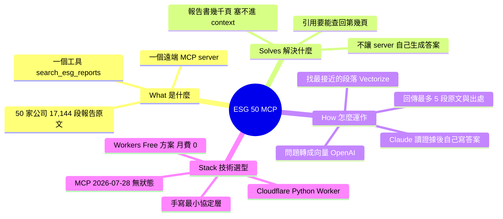
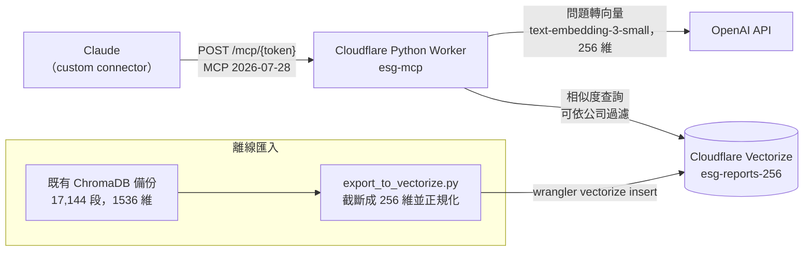
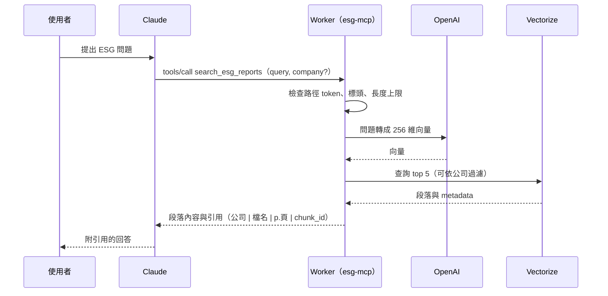

# 台灣 50 ESG 報告 MCP Server

> 讓 Claude 只靠一個網址，就能查詢台灣 50 成分股的 ESG 永續報告書，並回傳附頁碼的引用證據。

| | |
|---|---|
| **這是什麼** | 部署在 Cloudflare 上的遠端 MCP server。把網址加成 Claude 的 custom connector，Claude 就多了一個 `search_esg_reports` 工具。 |
| **解決什麼** | ESG 報告書動輒兩三百頁、50 家公司各一本。這個工具讓 Claude 回答「台積電範疇三排放怎麼揭露？」「哪些金控設了 2050 淨零目標？」時，引用的是報告原文，並附上公司、檔名、頁碼，可以回頭查證。 |
| **怎麼運作** | 問題先轉成向量，再到向量資料庫比對 17,144 個報告段落，回傳最相關的 5 段。最後的回答由 Claude 統整。 |

## 架構

## 一次查詢的流程

## 我的部署

| 項目 | 實際狀況 |
|---|---|
| 平台 | Cloudflare Workers **Free** 方案加上 Vectorize，固定成本 0 元，關掉電腦也能用 |
| 資料 | 50 家公司、17,144 個段落，沿用既有的 OpenAI 1536 維向量，截斷成 256 維，不必重新 embed |
| 回應速度 | 一次查詢總耗時中位數約 0.5 秒（`tools/call` wall 488 ms），含 OpenAI 與 Vectorize |
| 檢索品質 | 256 維與原本 1536 維的 top 5 重疊率：不限公司 72%、限定公司 80% |
| 每次查詢費用 | 約 0.000001 美元（只有問題轉向量要付費） |
| 防濫用 | 網址帶隨機 token，不符一律 404、不呼叫 OpenAI；query 最多 500 字、body 最多 16 KiB；OpenAI 預付 5 美元當硬上限 |
| 品質保證 | 21 個自動化測試、上線前做過安全審查並修正 |

### 幾個技術決定

- **自己寫 MCP 協定層，不用官方 SDK。** 在 Workers 實測，官方 Python SDK 打包後 5.2 MB，新 isolate 每次要花 200 到 1,200 ms CPU；手寫最小協定層只有 33 KB，CPU 中位數約 15 到 20 ms。
- **用 MCP 2026-07-28 無狀態協定。** 每個請求獨立，不需要 session 或長連線，所以能跑在 serverless 上。舊版 client 也相容。
- **向量截斷成 256 維。** OpenAI 這個模型支援 Matryoshka 截斷，256 維剛好放得進 Vectorize Free 的 500 萬維儲存上限，也不用重跑 17,144 段 embedding。

## 演進

- **v1（`v1.0.0`）：** 本機 stdio MCP server 加 ChromaDB，要在自己電腦裝環境、放索引檔才能用。程式仍在 `src/claude_esg_mcp/`，作為本機開發模式。
- **v2（`v2.0.0`，目前）：** 搬到 Cloudflare，變成任何 Claude 只要一個網址就能用的遠端服務。

## 延伸閱讀

- [ADR-005：為什麼選 Cloudflare Workers + Vectorize](docs/decisions/005-cloudflare-serverless.md)：選項比較、CPU 實測、成本、已知限制
- [安全審查](docs/security-review.md)
- [Worker 部署細節](worker/README.md)
- [所有架構決策紀錄](docs/decisions/)
