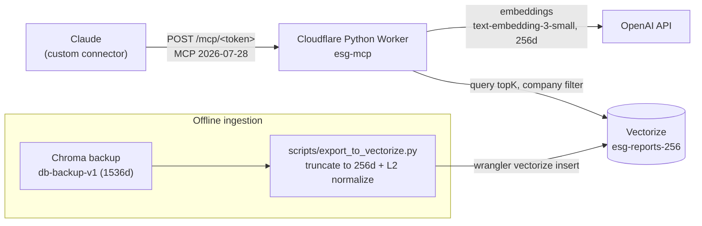
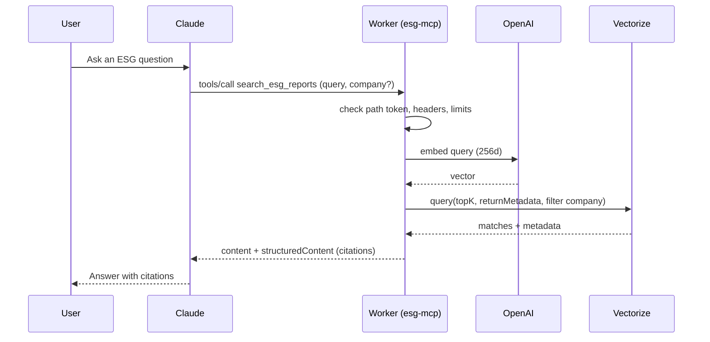

# Claude ESG MCP Server

Claude-first MCP server for retrieving citation-ready evidence from ESG reports of 50 Taiwan listed companies (Taiwan 50 constituents, 17,144 chunks).

**v2 (current): remote server.** Paste one URL into Claude as a custom connector; no local setup. It runs as a Cloudflare Python Worker plus a Vectorize index on the Workers Free plan. See [`worker/README.md`](worker/README.md) and [ADR-005](docs/decisions/005-cloudflare-serverless.md).

**v1: local stdio + ChromaDB.** Kept unchanged as the local development mode (tag `v1.0.0`). See [Local Development (stdio)](#local-development-stdio).

## What It Does

- Exposes a single MCP tool: `search_esg_reports(query, company?, top_k<=5, strategy="vector")`
- Generates query embeddings with OpenAI `text-embedding-3-small` (remote: 256 dims; local: 1536 dims)
- Returns bounded evidence chunks with `company`, `source_file`, `page`, `chunk_id`, `content`, `score`, and `citation` (`公司 | 檔名 | p.頁 | chunk_id`)
- Leaves final answer synthesis to Claude

## Architecture (v2 remote)





## Remote Usage (v2)

1. Deploy following [`worker/README.md`](worker/README.md) (Vectorize index, export, secrets `OPENAI_API_KEY` and `MCP_PATH_TOKEN`, deploy).
2. In Claude: Settings -> Connectors -> Add custom connector, URL `https://esg-mcp.<subdomain>.workers.dev/mcp/<MCP_PATH_TOKEN>`, no auth.
3. The path token works like a password. Any other path returns 404 and never calls OpenAI.

Cost and abuse controls, CPU measurements and known limitations: [ADR-005](docs/decisions/005-cloudflare-serverless.md). Security review: [docs/security-review.md](docs/security-review.md).

## Repository Layout

```text
src/claude_esg_mcp/   v1 local stdio server (ChromaDB)
worker/               v2 Cloudflare Worker (src/worker.py, wrangler.jsonc, tests/)
scripts/              export_to_vectorize.py, quality_check.py, quality_proxy.py
docs/decisions/       ADR-001 to ADR-005
openspec/             specs and change history
tests/                v1 tests
```

## Project Metadata

- License: MIT
- Package metadata lives in `pyproject.toml`
- Repository: <https://github.com/WilliamCHIU-ETH/MCP_ESG_index50>

## Local Development (stdio)

The v1 stdio server needs a local ChromaDB index and is meant for development.

### Local Run

This project standardizes on Python 3.12, `uv`, and a local `.venv`.

Prerequisites:

- `uv`
- Python 3.12 available to `uv`

```bash
make setup
make run
```

Required environment variables:

- `OPENAI_API_KEY`
- `CLAUDE_ESG_INDEX_PATH`, pointing to a local ChromaDB index directory

Optional environment variables:

- `CLAUDE_ESG_COLLECTION_NAME` default: `esg_reports_50`
- `CLAUDE_ESG_EMBEDDING_MODEL` default: `text-embedding-3-small`
- `CLAUDE_ESG_MAX_TOP_K` default: `5`
- `CLAUDE_ESG_MAX_CONTENT_CHARS` default: `1200`

Copy `.env.example` to `.env` for local runtime values. The template is intentionally early-stage and may change as the project evolves. The ESG vector database is not included in this public repo.

### Developer Workflow

Install pre-commit hooks once per clone:

```bash
make pre-commit-install
```

Run formatting and lint checks:

```bash
make lint
make format
```

`pre-commit` runs `ruff format` and `ruff check` before each commit, so formatting and linting become part of the local commit path instead of a command you need to remember manually.

### Claude Desktop Config

Example Claude Desktop MCP config:

```json
{
  "mcpServers": {
    "claude-esg-mcp": {
      "command": "uv",
      "args": ["run", "claude-esg-mcp"],
      "cwd": "/absolute/path/to/MCP_ESG_index50",
      "env": {
        "OPENAI_API_KEY": "YOUR_OPENAI_API_KEY",
        "CLAUDE_ESG_INDEX_PATH": "/absolute/path/to/esg_50_vector_db",
        "CLAUDE_ESG_COLLECTION_NAME": "esg_reports_50",
        "CLAUDE_ESG_EMBEDDING_MODEL": "text-embedding-3-small",
        "CLAUDE_ESG_MAX_TOP_K": "5",
        "CLAUDE_ESG_MAX_CONTENT_CHARS": "1200"
      }
    }
  }
}
```

### Verification Commands

Run unit and contract tests. These tests must not call OpenAI, ChromaDB, or other real external services:

```bash
make test
```

Run integration tests. These may exercise multiple project components, but should still avoid real external services unless explicitly marked as smoke tests:

```bash
make integration
```

Run opt-in live smoke tests after configuring `.env`. Smoke tests may call OpenAI and the configured ESG ChromaDB index:

```bash
make smoke
```

Test layout:

```text
tests/
├── conftest.py          # Shared pytest import path setup and future fixtures
├── unit/                # Pure unit tests with fakes/mocks only
├── integration/         # Cross-component tests without live external services
└── smoke/               # Live API/index tests, skipped unless env is configured
```

Mocking rule: unit tests use fakes, `unittest.mock`, or `pytest-mock`; integration tests and above are the only layers allowed to touch broader runtime dependencies. Live external dependencies belong in `tests/smoke/`.

Verify the MCP tool is registered:

```bash
uv run python - <<'PY'
import asyncio
from claude_esg_mcp.server import build_mcp_server

class FakeRetrievalService:
    def search_esg_reports(self, **kwargs):
        return {"query": kwargs["query"], "strategy": "vector", "results": []}

async def main():
    server = build_mcp_server(retrieval_service=FakeRetrievalService())
    tools = await server.list_tools()
    print([tool.name for tool in tools])

asyncio.run(main())
PY
```

Worker tests (no network; stubs the Workers runtime):

```bash
cd worker && python -m pytest tests -q
```
